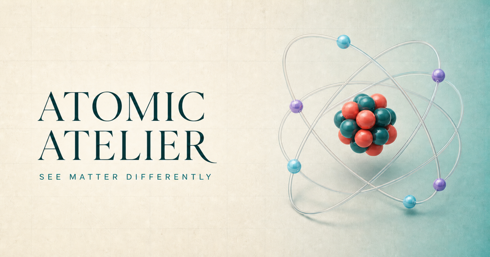

# Atomic Atelier

Atomic Atelier is an interactive chemistry learning app for exploring all 118 elements through 3D teaching models, periodic trends, quizzes, and comparisons. It also includes a guided reaction lab where students can balance 12 foundational equations and watch atoms rearrange.



## Features

- Explore all 118 elements with searchable and filterable element data.
- Inspect simplified, interactive 3D atomic models built with Three.js.
- Compare element properties and periodic trends side by side.
- Browse a keyboard-accessible periodic table.
- Test element knowledge with deterministic quizzes.
- Balance 12 guided chemical equations, visualize atom conservation, and receive technique grades with strategy feedback.
- Start with an interactive outer-electron task, then follow a five-activity Carbon → Nitrogen → periodic trends → CO₂ lesson.
- Practice prediction questions, review missed concepts, and retry them without replacing full-quiz scores.
- Open inline explanations for chemistry terms and continue from a local progress dashboard.
- Save favorites, explored elements, quiz scores, reaction grades, and recent activity locally.
- Install the app and revisit the element explorer or reaction lab offline.
- Use compact mobile viewers with opt-in touch rotation, fullscreen expansion, and visible studio controls in light and dark themes.
- Compare one period or group in the mobile Trends table, with full-table 2D and 3D views still available.
- Navigate all six learning resources through numbered pages, and expand mobile footer sections when needed.
- Use the responsive interface on desktop and mobile, with reduced-motion support.


## Element data

The app reads from the committed snapshot in `src/data/elements.json`, so neither the browser nor the production build requires a runtime chemistry API.

`npm run data:sync` refreshes the snapshot from PubChem periodic-table and PUG-View records. The script derives shell occupancy, selects representative isotopes when supported by abundance data, normalizes nullable properties, attaches PubChem, IUPAC, and NIST references, and validates the generated records. Changes to names, standard atomic weights, or other evaluated properties should still be checked against the linked authoritative sources before committing a refreshed snapshot.

Energy fields in the snapshot are in eV per atom. `src/lib/elementProperties.ts` converts ionization energy and electron affinity to kJ/mol using the exact SI elementary charge and Avogadro constant, and supplies shared units and formatting for facts, comparisons, charts, and exported study cards. Zero and unavailable values are handled separately.

## Persistence and privacy

Progress is stored only in the browser under the `atomic-atelier:v1` local-storage key. The optional guided lesson stores its current activity under `atomic-atelier:carbon-lesson:v1`; the first-task dismissal uses `atomic-atelier:tour-complete:v1`. The dismissible lesson invitation stores only its visibility preference under `atomic-atelier:lesson-invitation-hidden:v1`. It can always be reopened from Tools → Guided lesson. The app has no accounts, analytics payload, database, cloud synchronization, notes, or collection of personally identifiable information.

Stored preferences include favorites, explored and recent elements, quiz scores, completed reactions, reaction technique grades, last selections, and the auto-rotate setting. If browser storage is missing, blocked, outdated, or malformed, the app falls back to safe defaults.

## Offline installation

The App Router manifest and production service worker make Atomic Atelier installable. The service worker precaches the application routes, their generated Next.js assets, and the application icons. Same-origin navigations use a network-first strategy with cached route fallbacks, while hashed static assets use cache-first delivery. Service-worker registration is production-only so local development always reflects current code.

## Teaching-model limitations

Atomic shell paths, particle spacing, relative scale, and reaction geometry are intentionally simplified for teaching. The reaction animations demonstrate conservation of atom identities and schematic bond rearrangement; they are not quantum-orbital, kinetic, or reaction-mechanism simulations.

Safety notes are conceptual. Atomic Atelier does not provide experimental quantities or laboratory procedures.

## Project structure

```text
src/
├── app/                    # Pure routing layer (pages, layout, metadata)
│   ├── molecules/page.tsx  # /molecules route (VSEPR Studio)
│   ├── reactions/page.tsx  # /reactions route (Reaction Lab)
│   ├── trends/page.tsx     # /trends route (Periodic Trends)
│   ├── layout.tsx          # Root shell layout & fonts
│   ├── template.tsx        # Page transition animations
│   ├── page.tsx            # / route (Atomic Explorer)
│   └── manifest.ts, robots.ts, sitemap.ts
├── features/               # Feature-driven domain modules (UI + Math + Types)
│   ├── explorer/           # Atomic Explorer, 3D AtomViewer, PeriodicTable, Orbitals
│   ├── molecules/          # 3D Molecule Studio, Lewis Structures, VSEPR
│   ├── reactions/          # Chemistry Reaction Lab & 3D Stoichiometry
│   └── trends/             # Periodic Trends 3D Elevation & Heatmaps
├── components/             # Shared UI components (AppHeader, AppFooter, Dialog, PWAClient)
├── hooks/                  # Reusable React hooks (useProgress, useSheetGesture)
├── data/                   # Static datasets (elements.json)
├── styles/                 # Global styles & themes (globals.css, apple-overhaul.css)
└── types/                  # Centralized TypeScript definitions
public/                     # Minimal production PWA assets & social preview
scripts/                    # Element data synchronization (sync-elements.mjs)
test/                       # Unit (Vitest) and E2E (Playwright) suites
```

## Forking & Customizing

Atomic Atelier is designed to be easily forked, modified, and extended:

- **Atomic Content & Educational Cards**: Edit [`src/features/explorer/components/AtomicContent.tsx`](src/features/explorer/components/AtomicContent.tsx) to customize atomic profile facts, isotope notes, and the 6 educational resource cards.
- **Element Data**: Periodic data is stored in [`src/data/elements.json`](src/data/elements.json) and synced via `npm run data:sync` ([`scripts/sync-elements.mjs`](scripts/sync-elements.mjs)).
- **Molecules & VSEPR**: Add or adjust molecular models, 3D positions, lone pairs, and dipole moments in [`src/features/molecules/lib/molecules.ts`](src/features/molecules/lib/molecules.ts) and [`src/features/molecules/lib/vsepr.ts`](src/features/molecules/lib/vsepr.ts).
- **Chemical Reactions**: Add new synthesis, decomposition, or combustion reactions with atom mappings in [`src/features/reactions/lib/reactions.ts`](src/features/reactions/lib/reactions.ts).
- **Periodic Trends**: Add new properties or color palettes in [`src/features/trends/lib/trends.ts`](src/features/trends/lib/trends.ts).

## Tech stack

- [Next.js 16](https://nextjs.org/) and React 19
- TypeScript
- Three.js for atomic models
- GSAP for interface motion
- Tailwind CSS 4/PostCSS
- Vitest and Testing Library for unit tests
- Playwright for end-to-end and visual tests

